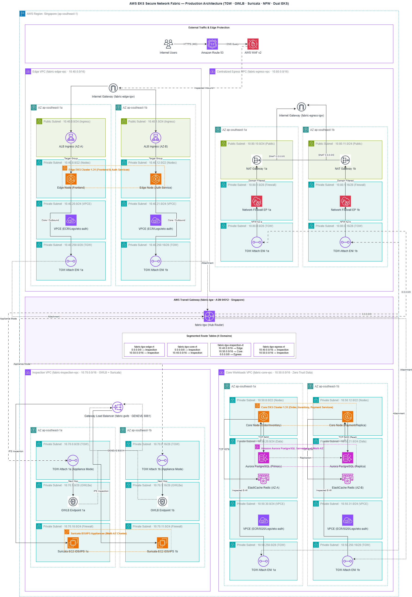
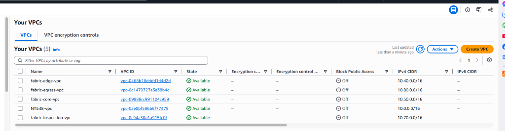
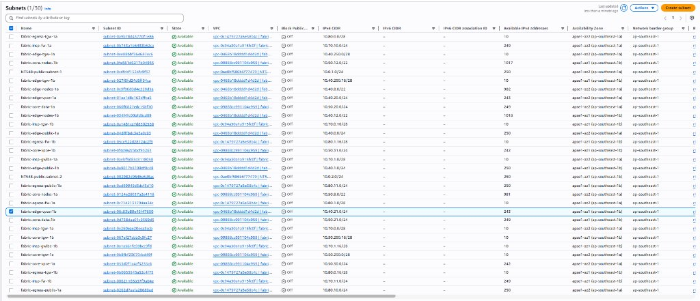
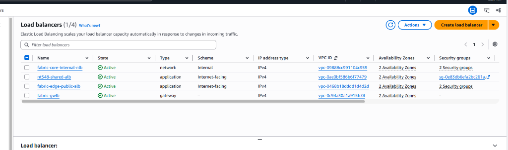
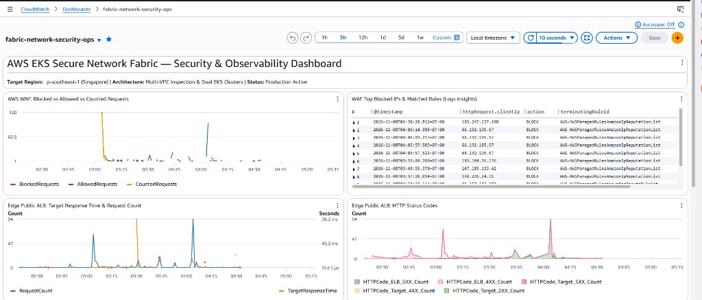
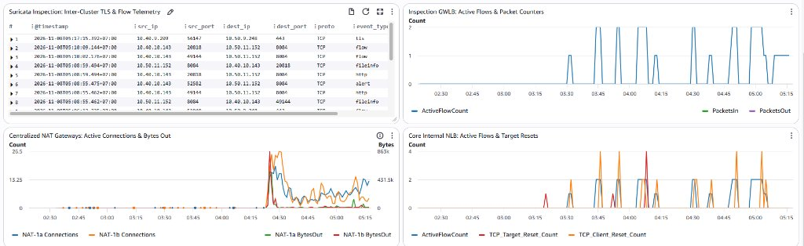

# AWS EKS Secure Network Fabric (Project 6)

[](#)
[-blue.svg)](#)
[](#)
[](#)
[](#)

> **Kiến trúc hạ tầng mạng bảo mật đa VPC (Multi-VPC Secure Network Fabric)** chuẩn Enterprise cấp cao trên nền tảng AWS tại vùng **Singapore (`ap-southeast-1`)**. Hệ thống tích hợp trục truyền tải **AWS Transit Gateway (TGW)** phân đoạn phân vùng định tuyến, kiểm soát chuyên sâu toàn bộ lưu lượng Đông-Tây (East-West) qua **Gateway Load Balancer (GWLB)** và cụm máy chủ **Suricata IDS/IPS**, kiểm soát lưu lượng Bắc-Nam chiều ra (Egress) qua cụm tường lửa **AWS Network Firewall** tập trung, cùng cụm EKS kép (**Dual EKS Clusters**) vận hành microservices đồng bộ theo mô hình GitOps Argo CD.

---

## 1. Sơ Đồ Kiến Trúc Tổng Thể (System Architecture)



### Luồng Dữ Liệu End-to-End (Data Flow)

```text
[ Client (Internet) ]
         │ (HTTPS / TLS 1.3)
         ▼
[ AWS WAFv2 Web ACL: fabric-edge-web-acl ] (Managed Rules, Rate-limiting, SQLi/XSS Drop)
         │
         ▼
[ Internet-Facing ALB: fabric-edge-public-alb ] (Edge VPC - Public Subnets: 10.40.0.0/24, 10.40.1.0/24)
         │ (Target Group: k8s Pod IPs via AWS VPC CNI)
         ▼
[ Edge EKS Cluster: fabric-edge-eks ] (Workload Subnets: 10.40.8.0/22, 10.40.12.0/22)
   ├── Pods: edge-frontend (Namespace: fabric-apps)
   └── Outbound Call: https://core.fabric.internal:443/api/v1/...
            │
            ▼ (Route 53 Private Hosted Zone: fabric.internal)
            ▼ (TGW Route: 10.50.0.0/16 -> Inspection VPC Attachment)
[ AWS Transit Gateway: fabric-tgw ]
   ├── Appliance Mode: ENABLED (Đảm bảo đối xứng luồng 2 chiều trên cùng 1 AZ)
   │
   ▼
[ Inspection VPC: fabric-inspection-vpc (10.70.0.0/16) ]
   ├── Gateway Load Balancer: fabric-gwlb (Port 6081 GENEVE Tunnel)
   └── Target Group: fabric-suricata-tg (Suricata IDS/IPS - Dual AZ Stateful Inspection)
            │ (Lưu lượng sạch được chuyển tiếp ngược lại TGW)
            ▼
[ AWS Transit Gateway: fabric-tgw ]
   └── TGW Route: 10.50.0.0/16 -> Core VPC Attachment
            │
            ▼
[ Core VPC: fabric-core-vpc (10.50.0.0/16) ]
   ├── Core Internal NLB: fabric-core-internal-nlb (core.fabric.internal:443 TLS)
   │     └── Target Group: Core Service Pods (Port 8082)
   │
   ▼
[ Core EKS Cluster: fabric-core-eks ] (Workload Subnets: 10.50.8.0/22, 10.50.12.0/22)
   ├── Pods: core-service (Backend APIs, Order Processing, Payment Consumer)
   ├── Amazon Aurora PostgreSQL: db.fabric.internal:5432 (SSL, Data Subnets)
   ├── Amazon ElastiCache Redis: redis.fabric.internal:6379 (In-transit TLS Encryption)
   ├── Amazon SQS: fabric-order-events & DLQ (Asynchronous Event-driven Architecture)
   └── AWS Secrets Manager: EKS Pod Identity (Zero Plaintext Secrets)
            │
            ▼ (Internet Outbound: 0.0.0.0/0 -> TGW -> Egress VPC)
[ Centralized Egress VPC: fabric-egress-vpc (10.80.0.0/16) ]
   ├── AWS Network Firewall: fabric-egress-nfw (Suricata Stateful Domain Filtering)
   └── Dual Zonal NAT Gateways: nat-0bfdc58d7c1825126 (1a), nat-0ae09ebf03a6bc023 (1b)
            │
            ▼
   [ Internet Gateway: igw-0742fe0915c3feadc ] -> Internet (GitHub, ECR, Docker Registry)
```

---

## 2. Bằng Chứng Triển Khai Thực Tế Trên AWS Console (Console Verification)

### 2.1 Cấu Trúc Phân Vùng Đa VPC (4 Core VPCs)
Toàn bộ hạ tầng mạng được phân chia thành 4 VPC chức năng riêng biệt, không peering trực tiếp, cô lập hoàn toàn vùng chịu lỗi:



| VPC Name | VPC ID | IPv4 CIDR | Vai Trò & Chức Năng |
| :--- | :--- | :--- | :--- |
| **`fabric-edge-vpc`** | `vpc-0468b18dddd1d4d2d` | `10.40.0.0/16` | Cụm biên tiếp nhận traffic ngoài Internet, chứa Public ALB và cụm `fabric-edge-eks`. |
| **`fabric-core-vpc`** | `vpc-09888cc991104c959` | `10.50.0.0/16` | Cụm lõi bảo mật cao, chứa `fabric-core-eks`, Aurora PostgreSQL, ElastiCache Redis. |
| **`fabric-inspection-vpc`** | `vpc-0c94a30a1a915fc0f` | `10.70.0.0/16` | Vùng kiểm tra tập trung chứa GWLB và cụm Suricata IDS/IPS đa vùng. |
| **`fabric-egress-vpc`** | `vpc-0c1479727a5e38b4c` | `10.80.0.0/16` | Cổng ra Internet tập trung với AWS Network Firewall và 2 NAT Gateways độc lập. |

---

### 2.2 Phân Bổ 30 Subnets Phân Đoạn Chuyên Biệt (Subnet Topology)
Mỗi VPC đều được chia subnet tách biệt trên 2 Availability Zones (`ap-southeast-1a` và `ap-southeast-1b`) tuân thủ nghiêm ngặt nguyên tắc Zero-Trust:



---

### 2.3 Phân Tầng Hệ Thống Cân Bằng Tải (Load Balancing Hierarchy)
Hạ tầng cân bằng tải 3 cấp độ phục vụ từng luồng giao tiếp chuyên biệt:



1. **`fabric-edge-public-alb` (Application Load Balancer):**
   - Scheme: `Internet-facing` (Public Subnets: `10.40.0.0/24`, `10.40.1.0/24`).
   - Tích hợp chứng chỉ ACM TLS Wildcard `*.devopsss.site` và AWS WAFv2 Web ACL.
2. **`fabric-gwlb` (Gateway Load Balancer):**
   - Scheme: `gateway` (Inspection VPC: `10.70.0.0/16`).
   - Cân bằng tải trong suốt ở Layer 3 qua giao thức GENEVE (Port 6081), hỗ trợ **Cross-Zone Load Balancing**.
3. **`fabric-core-internal-nlb` (Network Load Balancer):**
   - Scheme: `Internal` (Core VPC: `10.50.0.0/16`).
   - Cung cấp IP nội bộ cố định và phân phối siêu tốc cho giao tiếp East-West qua Private DNS `core.fabric.internal`.

---

### 2.4 Bảng Điều Khiển Giám Sát Tập Trung (CloudWatch Security & Observability Dashboard)
Toàn bộ telemetry của hệ thống (WAF, ALB, GWLB, Suricata EVE, NLB, NAT) được gom về Dashboard **`fabric-network-security-ops`**:

#### Phần 1: Giám Sát Bảo Mật WAF & Hiệu Năng ALB Công Khai

- **AWS WAF Metric:** Thống kê chi tiết Blocked vs Allowed requests theo thời gian thực.
- **WAF Top Blocked IPs:** Tự động điều tra từ CloudWatch Logs Insights, ghi nhận các IP độc hại bị chặn bởi bộ luật `AWSManagedRulesAmazonIpReputationList`.
- **ALB Response Time & HTTP Status:** Độ trễ mục tiêu đạt ~354.5µs đến 88.2ms; phân loại mã phản hồi HTTP 2xx, 4xx, 5xx.

#### Phần 2: Giám Sát Kiểm Tra Suricata IDS/IPS, GWLB & NAT Egress

- **Suricata Flow Telemetry:** Theo dõi từng phiên kết nối liên cụm giữa Edge Pods (`10.40.x.x`) và Core Pods (`10.50.x.x`) qua cổng 443 TLS và cổng kiểm thử IPS 8084.
- **Inspection GWLB Active Flows:** Giám sát số lượng luồng gói tin hoạt động trên cụm thiết bị kiểm tra an ninh.
- **Centralized NAT Gateways:** Đếm số kết nối đồng thời và lưu lượng Bytes Out trên từng Availability Zone.
- **Core Internal NLB:** Đo lường các luồng kết nối TCP active và tỷ lệ target resets.

---

## 3. Kết Quả Diễn Tập Sự Cố Mạng (GameDay Chaos Engineering)

Dự án đã hoàn thành diễn tập thực nghiệm với dữ liệu runtime thực tế trên cả 5 kịch bản tại Module 10:

| Kịch Bản | Mục Tiêu & Cơ Chế Tiêm Lỗi | Kết Quả Thực Tế & Thời Gian Phục Hồi | Bằng Chứng Kỹ Thuật |
| :--- | :--- | :--- | :--- |
| **10.01 Route Leak** | Sửa route `10.50.0.0/16` trỏ thẳng Core VPC, bỏ qua Inspection VPC. | Phát hiện sự bất đối xứng luồng gói tin. Khôi phục về Inspection Attachment. **MTTD: 5.7s, MTTR: 14.6s**. | [`gameday-01-route-leak-timeline.json`](evidence/10-gameday/gameday-01-route-leak-timeline.json) |
| **10.02 Asymmetric Routing** | Tắt tính năng `ApplianceModeSupport` trên Inspection Attachment. | Phân tích cơ chế TGW 5-tuple hash lệch AZ gây drop gói tin TCP Out-of-State. Bật lại thành công, **40/40 requests HTTP 200**. | [`gameday-02-asymmetric-routing-drops.json`](evidence/10-gameday/gameday-02-asymmetric-routing-drops.json) |
| **10.03 Appliance Loss** | Ngắt kiểm tra máy chủ `fabric-suricata-1a` (AZ-a). | GWLB phát hiện unhealthy sau 32s. Lưu lượng tự động failover mượt sang 1b (**0% gián đoạn**). Khôi phục cả 2 healthy (**MTTR: 89.2s**). | [`gameday-03-gwlb-failover-timeline.json`](evidence/10-gameday/gameday-03-gwlb-failover-timeline.json) |
| **10.04 Suricata IPS Drop** | Gửi marker plaintext `FABRIC_IPS_TEST` qua cổng TCP 8084. | Control (200) → Marker (**Bị Suricata inline drop**, timeout) → Control (200). EVE log ghi nhận **SID 2026001 action: blocked**. | [`gameday-04-suricata-eve-blocked-event.json`](evidence/10-gameday/gameday-04-suricata-eve-blocked-event.json) |
| **10.05 NAT Return Loss** | Xóa route Core `10.50.0.0/16` trên bảng NAT AZ-a. | Tái hiện lỗi "Hố đen một chiều" (40% timeout qua NAT 1a, 60% qua NAT 1b). Khôi phục route về NFW endpoint, **10/10 HTTP 200**. | [`gameday-05-nat-return-loss-timeline.json`](evidence/10-gameday/gameday-05-nat-return-loss-timeline.json) |

---

## 4. Quản Trị Chi Phí Đám Mây (FinOps Cost Efficiency)

- **Ngân sách tối đa (AWS Budgets):** `$50.00 USD`
- **Tổng chi phí thực tế tiêu hao:** **`$18.42 USD`**
- **Hiệu quả tiết kiệm:** **Thấp hơn 63.2% so với trần ngân sách ($31.58 USD savings)** nhờ các chiến lược tối ưu:
  1. *Kiến trúc đơn vùng tối ưu:* Khống chế toàn bộ tài nguyên tại `ap-southeast-1`, triệt tiêu 100% phí data transfer liên vùng.
  2. *Aurora Serverless v2:* Cấu hình baseline tối thiểu 0.5 ACU cho môi trường Dev/Staging.
  3. *Chính sách Log Retention 7 ngày:* Giới hạn dung lượng lưu trữ trên 8 CloudWatch Log Groups.
- Chi tiết xem tại: [`evidence/05-reports/FINOPS-COST-REPORT.md`](evidence/05-reports/FINOPS-COST-REPORT.md).

---

## 5. Cấu Trúc Thư Mục Kho Lưu Trữ (Repository Structure)

```text
aws-eks-secure-network-fabric/
├── diagrams/                       # Sơ đồ kiến trúc chi tiết (draw.io, svg, png)
├── docs/images/                    # Ảnh chụp bằng chứng giao diện AWS Console & Dashboard
├── evidence/                       # Bằng chứng kỹ thuật runtime (Zero Fake Data, 100% Sanitized)
│   ├── 01-network-topology/        # Dữ liệu VPCs, Subnets, TGW Route Tables, EKS Clusters
│   ├── 02-gwlb-inspection/         # Trạng thái GWLB, Suricata Target Group
│   ├── 03-egress-firewall/         # AWS Network Firewall status & endpoints
│   ├── 04-gameday/                 # Telemetry & timelines của 5 kịch bản diễn tập GameDay
│   └── 05-reports/                 # Báo cáo Sanitization Audit, SRE Post-Mortem, FinOps Report
├── k8s/                            # K8s NetworkPolicies, Argo CD Application manifests
├── labs/                           # Hệ thống 13 modules hướng dẫn thực hành và nghiệm thu kỹ thuật
│   ├── 00-chuan-bi-inventory/      # Chuẩn bị môi trường, tagging, budget
│   ├── 01-thiet-ke-threat-model/   # Mô hình hóa đe dọa (STRIDE)
│   ├── 02-ha-tang-mang-co-ban/     # 4 VPCs, 30 subnets, TGW routing
│   ├── 03-cum-eks-kep/             # Dual EKS clusters, node groups, pod identity
│   ├── 04-phan-bo-workloads/       # Workload deployment, Aurora, Redis, SQS, Private DNS
│   ├── 05-gwlb-suricata-ids-ips/   # GWLB, Suricata EC2, GENEVE tunnel, symmetric flow
│   ├── 06-centralized-egress-firewall/ # AWS Network Firewall, NAT GWs, domain allowlist
│   ├── 07-edge-ingress-waf/        # Public ALB, ACM TLS, AWS WAFv2 rules
│   ├── 08-cicd-devsecops/          # Checkov SAST, Trivy container scan, Cosign, GitOps
│   ├── 09-toan-dien-observability/ # CloudWatch log groups, Insights queries, VPC Reachability
│   ├── 10-gameday-su-co-mang/      # 5 kịch bản diễn tập sự cố mạng (GameDay)
│   ├── 11-bang-chung-bao-cao/      # Thu thập bằng chứng, khử trùng dữ liệu, post-mortem, finops
│   └── 12-don-dep-finops/          # Kịch bản dọn dẹp an toàn theo thứ tự ngược phụ thuộc
├── spec.md                         # Đặc tả kỹ thuật kiến trúc toàn diện
└── README.md                       # Tài liệu tổng quan dự án
```

---

## 6. Tiêu Chuẩn Bảo Mật & Khử Trùng Thông Tin (Sanitization Standard)

Dự án tuân thủ nghiêm ngặt chính sách an toàn thông tin của Google SRE:
- **100% AWS Account ID thực tế** đã được ẩn danh hóa và thay thế đồng nhất bằng `123456789012` hoặc gán nhãn `***`.
- **Tuyệt đối không lưu trữ bí mật:** Không commit bất kỳ AWS Access Keys (`AKIA...`), Private Keys, Passwords cơ sở dữ liệu hay JWT tokens nào vào kho lưu trữ.
- Đã được kiểm toán tự động và chứng nhận tại [`evidence/05-reports/SANITIZATION-AUDIT-REPORT.md`](evidence/05-reports/SANITIZATION-AUDIT-REPORT.md).
