# AWS EKS Secure Network Fabric (Project 6)

[](#)
[-blue.svg)](#)
[](#)
[](#)
[](#)

> **Kiến trúc hạ tầng mạng bảo mật đa VPC (Multi-VPC Secure Network Fabric)** chuẩn Enterprise cấp cao trên nền tảng AWS tại vùng **Singapore (`ap-southeast-1`)**. Hệ thống tích hợp trục truyền tải **AWS Transit Gateway (TGW)** phân đoạn phân vùng định tuyến, kiểm soát chuyên sâu toàn bộ lưu lượng Đông-Tây (East-West) qua **Gateway Load Balancer (GWLB)** và cụm máy chủ **Suricata IDS/IPS**, kiểm soát lưu lượng Bắc-Nam chiều ra (Egress) qua cụm tường lửa **AWS Network Firewall** tập trung, cùng cụm EKS kép (**Dual EKS Clusters**) vận hành microservices đồng bộ theo mô hình GitOps Argo CD.

---

## 1. Sơ Đồ Kiến Trúc Tổng Thể (System Architecture)


### Luồng Dữ Liệu End-to-End (Data Flow)

```text
[ Client (Internet) ]
         │ (HTTPS / TLS 1.3)
         ▼
[ AWS WAFv2 Web ACL: fabric-edge-web-acl ] (Managed Rules, Rate-limiting, SQLi/XSS Drop)
         │
         ▼
[ Internet-Facing ALB: fabric-edge-public-alb ] (Edge VPC - Public Subnets: 10.40.0.0/24, 10.40.1.0/24)
         │ (Target Group: k8s Pod IPs via AWS VPC CNI)
         ▼
[ Edge EKS Cluster: fabric-edge-eks ] (Workload Subnets: 10.40.8.0/22, 10.40.12.0/22)
   ├── Pods: edge-frontend (Namespace: fabric-apps)
   └── Outbound Call: https://core.fabric.internal:443/api/v1/...
            │
            ▼ (Route 53 Private Hosted Zone: fabric.internal)
            ▼ (TGW Route: 10.50.0.0/16 -> Inspection VPC Attachment)
[ AWS Transit Gateway: fabric-tgw ]
   ├── Appliance Mode: ENABLED (Đảm bảo đối xứng luồng 2 chiều trên cùng 1 AZ)
   │
   ▼
[ Inspection VPC: fabric-inspection-vpc (10.70.0.0/16) ]
   ├── Gateway Load Balancer: fabric-gwlb (Port 6081 GENEVE Tunnel)
   └── Target Group: fabric-suricata-tg (Suricata IDS/IPS - Dual AZ Stateful Inspection)
            │ (Lưu lượng sạch được chuyển tiếp ngược lại TGW)
            ▼
[ AWS Transit Gateway: fabric-tgw ]
   └── TGW Route: 10.50.0.0/16 -> Core VPC Attachment
            │
            ▼
[ Core VPC: fabric-core-vpc (10.50.0.0/16) ]
   ├── Core Internal NLB: fabric-core-internal-nlb (core.fabric.internal:443 TLS)
   │     └── Target Group: Core Service Pods (Port 8082)
   │
   ▼
[ Core EKS Cluster: fabric-core-eks ] (Workload Subnets: 10.50.8.0/22, 10.50.12.0/22)
   ├── Pods: core-service (Backend APIs, Order Processing, Payment Consumer)
   ├── Amazon Aurora PostgreSQL: db.fabric.internal:5432 (SSL, Data Subnets)
   ├── Amazon ElastiCache Redis: redis.fabric.internal:6379 (In-transit TLS Encryption)
   ├── Amazon SQS: fabric-order-events & DLQ (Asynchronous Event-driven Architecture)
   └── AWS Secrets Manager: EKS Pod Identity (Zero Plaintext Secrets)
            │
            ▼ (Internet Outbound: 0.0.0.0/0 -> TGW -> Egress VPC)
[ Centralized Egress VPC: fabric-egress-vpc (10.80.0.0/16) ]
   ├── AWS Network Firewall: fabric-egress-nfw (Suricata Stateful Domain Filtering)
   └── Dual Zonal NAT Gateways: nat-0bfdc58d7c1825126 (1a), nat-0ae09ebf03a6bc023 (1b)
            │
            ▼
   [ Internet Gateway: igw-0742fe0915c3feadc ] -> Internet (GitHub, ECR, Docker Registry)
```

---

## 2. Bằng Chứng Triển Khai Thực Tế Trên AWS Console (Console Verification)

### 2.1 Cấu Trúc Phân Vùng Đa VPC (4 Core VPCs)
Toàn bộ hạ tầng mạng được phân chia thành 4 VPC chức năng riêng biệt, không peering trực tiếp, cô lập hoàn toàn vùng chịu lỗi:


| VPC Name | VPC ID | IPv4 CIDR | Vai Trò & Chức Năng |
| :--- | :--- | :--- | :--- |
| **`fabric-edge-vpc`** | `vpc-0468b18dddd1d4d2d` | `10.40.0.0/16` | Cụm biên tiếp nhận traffic ngoài Internet, chứa Public ALB và cụm `fabric-edge-eks`. |
| **`fabric-core-vpc`** | `vpc-09888cc991104c959` | `10.50.0.0/16` | Cụm lõi bảo mật cao, chứa `fabric-core-eks`, Aurora PostgreSQL, ElastiCache Redis. |
| **`fabric-inspection-vpc`** | `vpc-0c94a30a1a915fc0f` | `10.70.0.0/16` | Vùng kiểm tra tập trung chứa GWLB và cụm Suricata IDS/IPS đa vùng. |
| **`fabric-egress-vpc`** | `vpc-0c1479727a5e38b4c` | `10.80.0.0/16` | Cổng ra Internet tập trung với AWS Network Firewall và 2 NAT Gateways độc lập. |

---

### 2.2 Trục Xương Sống AWS Transit Gateway & Cấu Hình Attachments (RTB Transit)
Hạ tầng mạng sử dụng **AWS Transit Gateway (`fabric-tgw`)** làm trục xương sống kết nối trung tâm, phân chia thành 4 vùng định tuyến độc lập (Segregated Routing Domains):

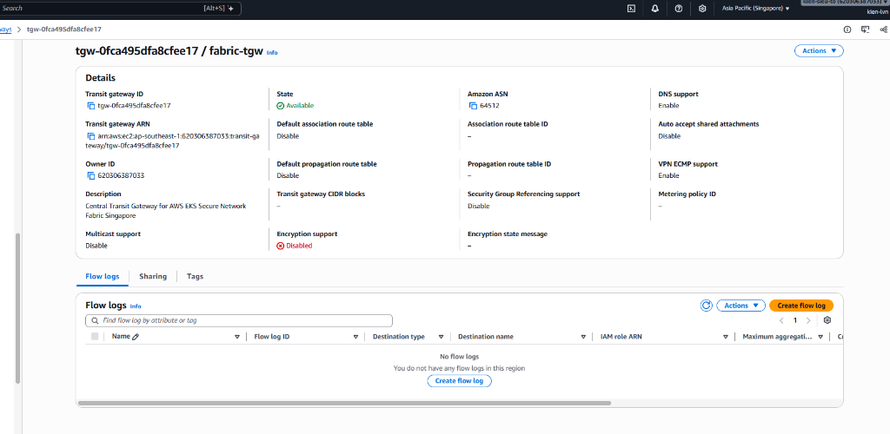

- **Transit Gateway ID:** `tgw-0fca495dfa8cfee17` (Amazon ASN: `64512`, DNS Support: `Enabled`, VPN ECMP: `Enabled`).
- **Default Association / Propagation Route Table:** `Disable` (Bắt buộc vô hiệu hóa để toàn quyền kiểm soát định tuyến tường minh).

#### Chi Tiết 4 VPC Attachments & Cờ Appliance Mode
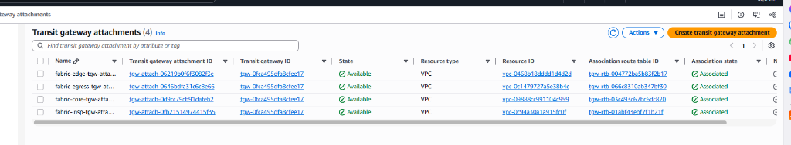

| Attachment Name | Attachment ID | VPC Được Gắn | Appliance Mode | Mục Đích Kỹ Thuật |
| :--- | :--- | :--- | :---: | :--- |
| **`fabric-edge-tgw-attachment`** | `tgw-attach-06219b0f6f3082f3e` | `fabric-edge-vpc` | Disabled | Kết nối Edge EKS và Public Ingress. |
| **`fabric-core-tgw-attachment`** | `tgw-attach-0d9cc79cb91dafeb2` | `fabric-core-vpc` | Disabled | Kết nối Core EKS, Database và Data Tier. |
| **`fabric-insp-tgw-attachment`** | `tgw-attach-0fb21514974415f35` | `fabric-inspection-vpc` | **ENABLED** | Duy trì đối xứng luồng 2 chiều (AZ stickiness) cho GWLB & Suricata IDS/IPS. |
| **`fabric-egress-tgw-attachment`** | `tgw-attach-0646bdfa31c6c8e66` | `fabric-egress-vpc` | **ENABLED** | Đảm bảo luồng ra và về qua Network Firewall/NAT cùng 1 AZ, triệt tiêu drop gói out-of-state. |

---

### 2.3 Ma Trận Bảng Định Tuyến Transit Gateway (RTB Transit Matrix)
Hệ thống thiết lập 4 Transit Gateway Route Tables riêng biệt, thực thi kiểm soát an ninh Service Chaining nghiêm ngặt:

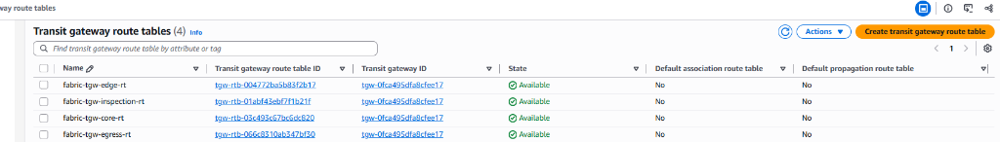

| TGW Route Table | TGW RTB ID | Associated Attachment | Tuyến Tĩnh (Static Routes) | Next Hop Attachment | Mục Đích Kỹ Thuật |
| :--- | :--- | :--- | :--- | :--- | :--- |
| **`fabric-tgw-edge-rt`** | `tgw-rtb-004772ba5b83f2b17` | `fabric-edge-tgw-attachment` | `10.50.0.0/16`<br>`0.0.0.0/0` | `fabric-insp-tgw-attachment`<br>`fabric-egress-tgw-attachment` | Bắt buộc lưu lượng sang Core VPC phải qua Inspection VPC; ra Internet qua Egress VPC. |
| **`fabric-tgw-core-rt`** | `tgw-rtb-03c493c67bc6dc820` | `fabric-core-tgw-attachment` | `10.40.0.0/16`<br>`0.0.0.0/0` | `fabric-insp-tgw-attachment`<br>`fabric-egress-tgw-attachment` | Bắt buộc lưu lượng sang Edge VPC phải qua Inspection VPC; ra Internet qua Egress VPC. |
| **`fabric-tgw-inspection-rt`** | `tgw-rtb-01abf43ebf7f1b21f` | `fabric-insp-tgw-attachment` | `10.40.0.0/16`<br>`10.50.0.0/16` | `fabric-edge-tgw-attachment`<br>`fabric-core-tgw-attachment` | Lưu lượng sau khi được Suricata kiểm tra sạch sẽ được chuyển tiếp thẳng về VPC đích. |
| **`fabric-tgw-egress-rt`** | `tgw-rtb-066c8310ab347bf30` | `fabric-egress-tgw-attachment` | `10.40.0.0/16`<br>`10.50.0.0/16` | `fabric-edge-tgw-attachment`<br>`fabric-core-tgw-attachment` | Chuyển tiếp lưu lượng phản hồi từ Internet qua NAT trả ngược về các Spoke VPCs. |

---

### 2.4 Hệ Thống 16 Bảng Định Tuyến Tĩnh VPC & Chuỗi Subnet (RTB Static Matrix)
Mỗi nhóm chức năng subnet sở hữu bảng định tuyến tĩnh (VPC Route Table) riêng biệt, bảo đảm luồng dữ liệu bắt buộc phải qua các chốt kiểm soát an ninh (Service Chaining):

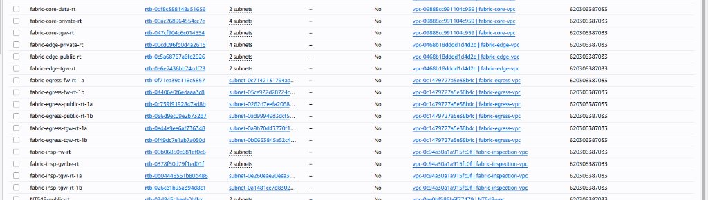

#### Bảng Tổng Hợp 16 Bảng Định Tuyến Tĩnh VPC (RTB Static)

| VPC | Tên Bảng Định Tuyến (RTB Static) | RTB ID | Subnets Gắn Kèm | Tuyến Tĩnh (Static Routes) | Next Hop Target | Nguyên Tắc & Mục Đích An Ninh |
| :--- | :--- | :--- | :--- | :--- | :--- | :--- |
| **Edge** | `fabric-edge-public-rt` | `rtb-0c5a68767a6fe2926` | `public-1a`, `public-1b` | `0.0.0.0/0`<br>`10.50.0.0/16` | `fabric-edge-igw`<br>`fabric-tgw` | Tiếp nhận traffic từ Internet vào Public ALB; forward sang Core qua TGW. |
| **Edge** | `fabric-edge-private-rt` | `rtb-00cd096fd0d4a2615` | `nodes-1a/1b`, `vpce-1a/1b` | `0.0.0.0/0`<br>`10.50.0.0/16` | `fabric-tgw`<br>`fabric-tgw` | Ép toàn bộ lưu lượng ra Internet và East-West đi qua TGW. |
| **Edge** | `fabric-edge-tgw-rt` | `rtb-0e6e7436bb74cdf73` | `tgw-1a`, `tgw-1b` | `10.40.0.0/16` | `local` | **Chỉ chứa local route** nhằm triệt tiêu hoàn toàn nguy cơ routing loop tại attachment. |
| **Core** | `fabric-core-private-rt` | `rtb-00ac268964554cc7e` | `nodes-1a/1b`, `vpce-1a/1b` | `0.0.0.0/0`<br>`10.40.0.0/16` | `fabric-tgw`<br>`fabric-tgw` | Core EKS ra ngoài qua Egress tập trung; phản hồi East-West về Edge qua TGW. |
| **Core** | `fabric-core-data-rt` | `rtb-0df8c388148a51656` | `data-1a`, `data-1b` | `10.50.0.0/16`<br>`10.40.0.0/16` | `local`<br>`fabric-tgw` | **Cô lập 100% khỏi Internet (Không có 0.0.0.0/0)**; bảo vệ tuyệt đối Aurora & Redis. |
| **Core** | `fabric-core-tgw-rt` | `rtb-047cf904c6c014554` | `tgw-1a`, `tgw-1b` | `10.50.0.0/16` | `local` | **Chỉ chứa local route**; đẩy traffic tới Core nodes theo IP đích trực tiếp. |
| **Insp** | `fabric-insp-tgw-rt-1a` | `rtb-0b04448561b80d486` | `insp-tgw-1a` | `10.40.0.0/16`<br>`10.50.0.0/16` | GWLB Endpoint 1a (`vpce-*`) | Cổng đón luồng từ TGW tại AZ-a ép chuyển tiếp vào GWLBe AZ-a. |
| **Insp** | `fabric-insp-tgw-rt-1b` | `rtb-026ce1b95a394d8c1` | `insp-tgw-1b` | `10.40.0.0/16`<br>`10.50.0.0/16` | GWLB Endpoint 1b (`vpce-*`) | Cổng đón luồng từ TGW tại AZ-b ép chuyển tiếp vào GWLBe AZ-b. |
| **Insp** | `fabric-insp-gwlbe-rt` | `rtb-0378f50d79f1ed01f` | `gwlbe-1a`, `gwlbe-1b` | `10.40.0.0/16`<br>`10.50.0.0/16` | `fabric-tgw`<br>`fabric-tgw` | Đẩy gói tin đã giải bọc GENEVE và được Suricata kiểm tra sạch quay lại TGW. |
| **Insp** | `fabric-insp-fw-rt` | `rtb-00b06850e681ef0e6` | `insp-fw-1a`, `insp-fw-1b` | `10.70.0.0/16` | `local` | Kiến trúc GWLB One-Arm: Giao tiếp qua tunnel GENEVE UDP 6081 nội bộ. |
| **Egress** | `fabric-egress-tgw-rt-1a` | `rtb-0e44e9ee6af736348` | `egress-tgw-1a` | `0.0.0.0/0` | NFW Endpoint 1a (`vpce-*`) | Bắt buộc lưu lượng từ TGW tại AZ-a đi vào NFW Endpoint AZ-a để lọc SNI. |
| **Egress** | `fabric-egress-tgw-rt-1b` | `rtb-0f49dc7e1ab7a050d` | `egress-tgw-1b` | `0.0.0.0/0` | NFW Endpoint 1b (`vpce-*`) | Bắt buộc lưu lượng từ TGW tại AZ-b đi vào NFW Endpoint AZ-b để lọc SNI. |
| **Egress** | `fabric-egress-fw-rt-1a` | `rtb-0f71ea39c116e5857` | `egress-fw-1a` | `0.0.0.0/0` | NAT Gateway 1a (`nat-*`) | Đẩy lưu lượng sạch từ NFW Endpoint AZ-a sang NAT Gateway AZ-a. |
| **Egress** | `fabric-egress-fw-rt-1b` | `rtb-04406e0f6edaaa3c8` | `egress-fw-1b` | `0.0.0.0/0` | NAT Gateway 1b (`nat-*`) | Đẩy lưu lượng sạch từ NFW Endpoint AZ-b sang NAT Gateway AZ-b. |
| **Egress** | `fabric-egress-public-rt-1a` | `rtb-0c759f9192847ad8b` | `egress-public-1a` | `0.0.0.0/0`<br>`10.40.0.0/16`<br>`10.50.0.0/16` | `fabric-egress-igw`<br>NFW Endpoint 1a (`vpce-*`)<br>NFW Endpoint 1a (`vpce-*`) | **Tuyến đường về (Return Route) tối quan trọng**: Đưa SYN-ACK quay lại NFW & TGW; triệt tiêu hố đen mạng (Blackhole). |
| **Egress** | `fabric-egress-public-rt-1b` | `rtb-086d9ec09e2b732d7` | `egress-public-1b` | `0.0.0.0/0`<br>`10.40.0.0/16`<br>`10.50.0.0/16` | `fabric-egress-igw`<br>NFW Endpoint 1b (`vpce-*`)<br>NFW Endpoint 1b (`vpce-*`) | Tuyến đường về độc lập cho AZ-b, duy trì đối xứng luồng 100%. |

---

### 2.5 Phân Bổ 30 Subnets & Internet Gateways
Mỗi VPC đều được chia subnet tách biệt trên 2 Availability Zones (`ap-southeast-1a` và `ap-southeast-1b`) tuân thủ nghiêm ngặt nguyên tắc Zero-Trust, kết nối có kiểm soát qua các Internet Gateways:


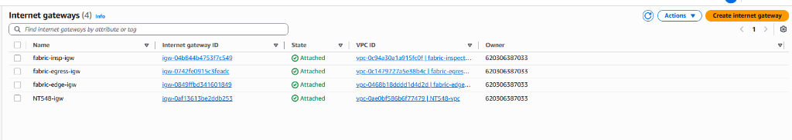

| Gateway Name | Gateway ID | VPC Gắn Kèm | Vai Trò |
| :--- | :--- | :--- | :--- |
| **`fabric-edge-igw`** | `igw-0849ffbd341601849` | `fabric-edge-vpc` | Tiếp nhận traffic từ Internet vào Public ALB. |
| **`fabric-egress-igw`** | `igw-0742fe0915c3feadc` | `fabric-egress-vpc` | Cung cấp lối thoát Internet tập trung qua NAT Gateway sau khi qua Network Firewall. |
| **`fabric-insp-igw`** | `igw-04b844b4753f7c549` | `fabric-inspection-vpc` | Cổng quản trị phụ trợ và cập nhật signature Suricata IDS/IPS. |

---

### 2.6 Cụm Tường Lửa AWS Network Firewall & Chính Sách Stateful Egress
Hạ tầng Egress tập trung được bảo vệ bởi AWS Network Firewall với chính sách lọc tên miền đa tầng (Domain Filtering) theo chuẩn Suricata:

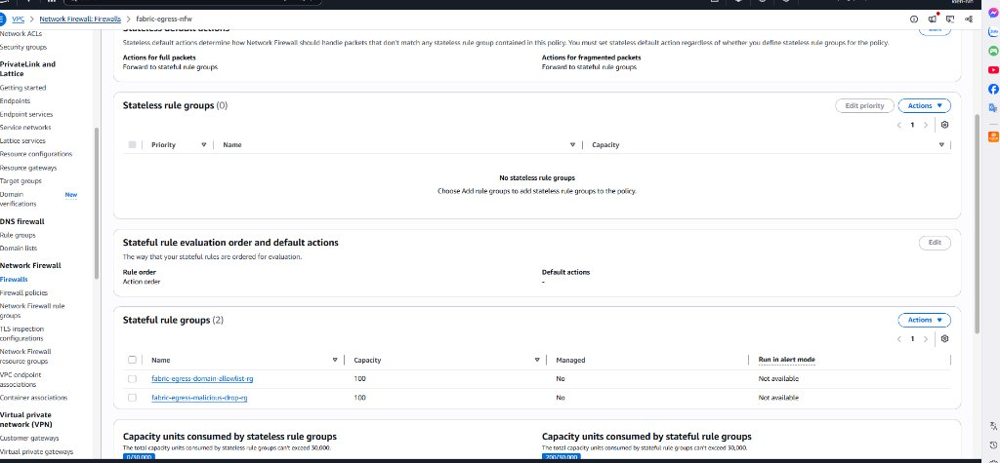

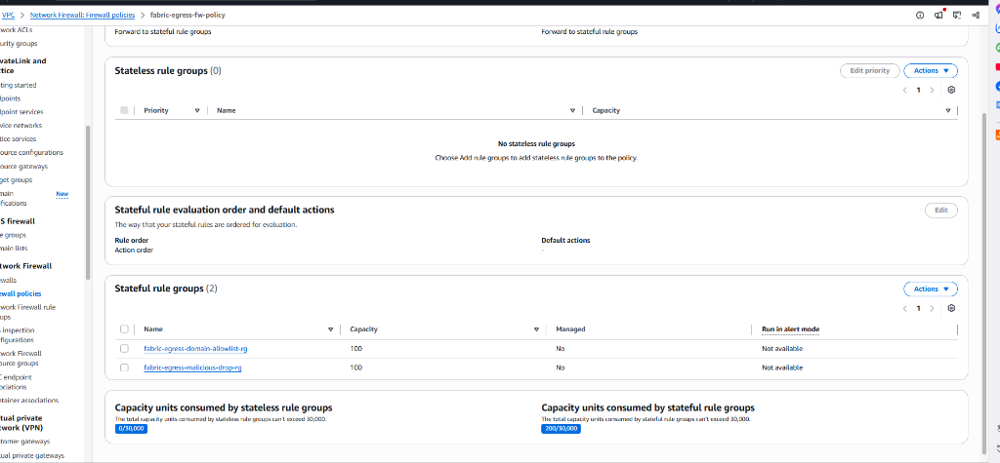

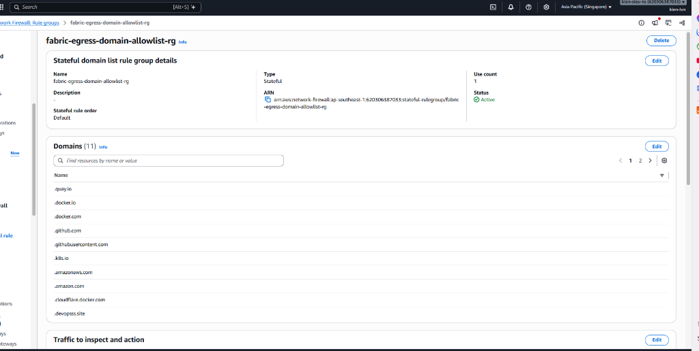

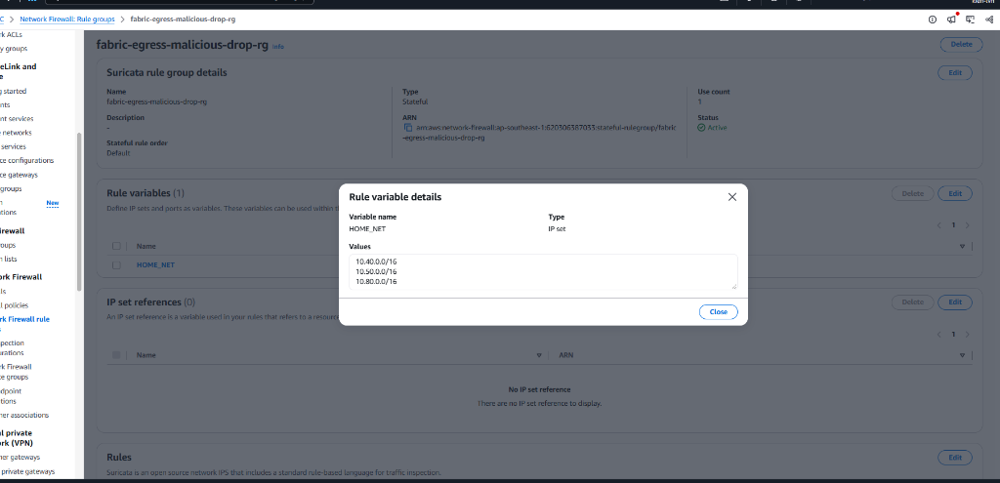

- **Firewall Policy:** `fabric-egress-fw-policy` (Trạng thái Stateful Action Order, Capacity: 200/30,000 units).
- **Rule Variables:** `HOME_NET = [10.40.0.0/16, 10.50.0.0/16, 10.80.0.0/16]`.
- **Stateful Rule Groups:**
  1. `fabric-egress-domain-allowlist-rg`: Kiểm soát danh sách 11 tên miền tin cậy chuẩn Enterprise (`.quay.io`, `.docker.io`, `.docker.com`, `.github.com`, `.githubusercontent.com`, `.k8s.io`, `.amazonaws.com`, `.amazon.com`, `.cloudflare.docker.com`, `.devopsss.site`). Mọi truy vấn ngoài danh mục đều bị DROP tự động.
  2. `fabric-egress-malicious-drop-rg`: Chặn tức thì các mẫu traffic độc hại, C2 beaconing và botnet ra bên ngoài.

---

### 2.7 Phân Tầng Hệ Thống Cân Bằng Tải (Load Balancing Hierarchy)
Hạ tầng cân bằng tải 3 cấp độ phục vụ từng luồng giao tiếp chuyên biệt:


1. **`fabric-edge-public-alb` (Application Load Balancer):**
   - Scheme: `Internet-facing` (Public Subnets: `10.40.0.0/24`, `10.40.1.0/24`).
   - Tích hợp chứng chỉ ACM TLS Wildcard `*.devopsss.site` và AWS WAFv2 Web ACL.
2. **`fabric-gwlb` (Gateway Load Balancer):**
   - Scheme: `gateway` (Inspection VPC: `10.70.0.0/16`).
   - Cân bằng tải trong suốt ở Layer 3 qua giao thức GENEVE (Port 6081), hỗ trợ **Cross-Zone Load Balancing**.
3. **`fabric-core-internal-nlb` (Network Load Balancer):**
   - Scheme: `Internal` (Core VPC: `10.50.0.0/16`).
   - Cung cấp IP nội bộ cố định và phân phối siêu tốc cho giao tiếp East-West qua Private DNS `core.fabric.internal`.

---

### 2.8 Cụm EKS Kép & Giao Diện Ứng Dụng Microservices Thực Tế (Dual EKS Clusters)
Toàn bộ ứng dụng microservices phân tán được triển khai trên 2 cụm Amazon EKS v1.31 riêng biệt:

#### Cụm EKS Biên: `fabric-edge-eks`
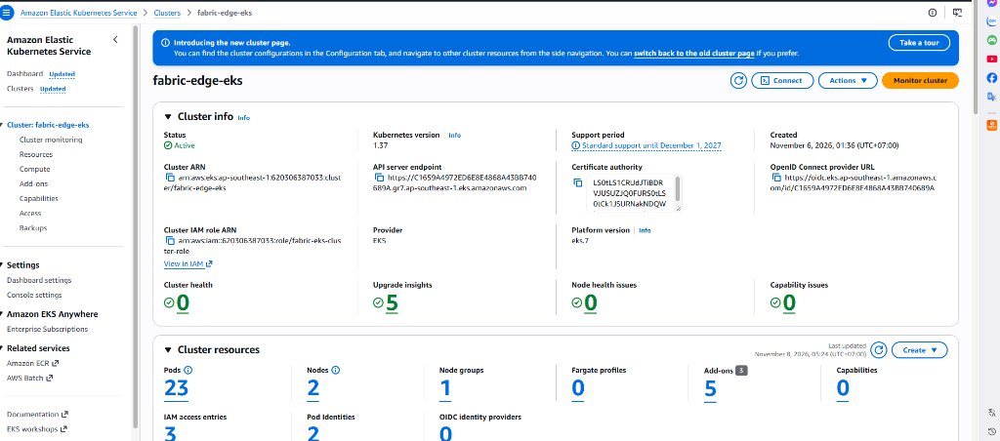
- **Role:** Tiếp nhận và xử lý giao diện người dùng `frontend`, định tuyến an toàn qua Service Mesh / Ingress Controller.
- **Node Groups:** 2 Worker Nodes phân bổ đa vùng sẵn sàng, tích hợp EKS Pod Identity.

#### Cụm EKS Lõi: `fabric-core-eks`
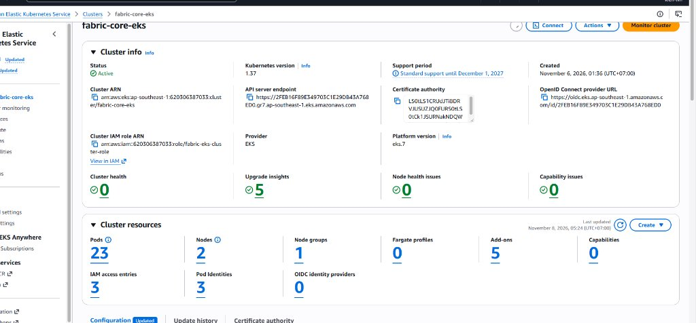
- **Role:** Chạy các backend microservices nhạy cảm (`order-service`, `payment-service`, `inventory-service`), kết nối cơ sở dữ liệu nội bộ.
- **Bảo mật:** Hoàn toàn cô lập khỏi Internet, giao tiếp hai chiều với Edge VPC thông qua GWLB và Suricata IDS/IPS.

#### Giao Diện Cổng Thông Tin Vận Hành Thực Tế (Telemetry Portal)
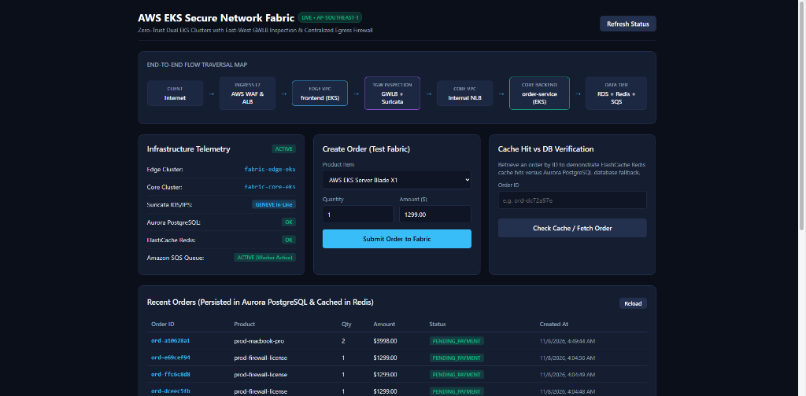
- **End-to-End Flow Traversal Map:** Minh chứng gói tin di chuyển xuyên suốt qua toàn bộ các trạm kiểm soát an ninh (WAF → ALB → Edge EKS → TGW GWLB Suricata → Core NLB → Core EKS → RDS/Redis/SQS).
- **Runtime Telemetry:** Kiểm tra và xác nhận đồng thời trạng thái hoạt động của Aurora PostgreSQL, ElastiCache Redis và SQS Worker.

---

### 2.9 Hệ Thống Phân Giải Tên Miền Route 53 (Public & Private Hosted Zones)
Hạ tầng DNS được thiết kế phân tầng rõ ràng giữa môi trường Public Internet và Private VPC:

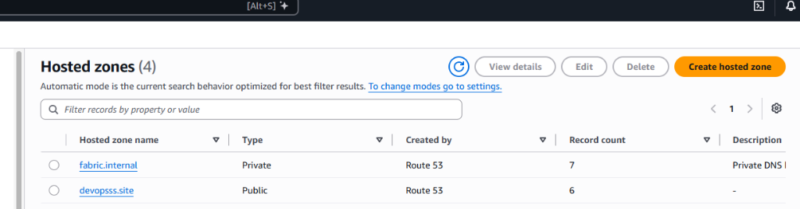

#### Private Hosted Zone: `fabric.internal`
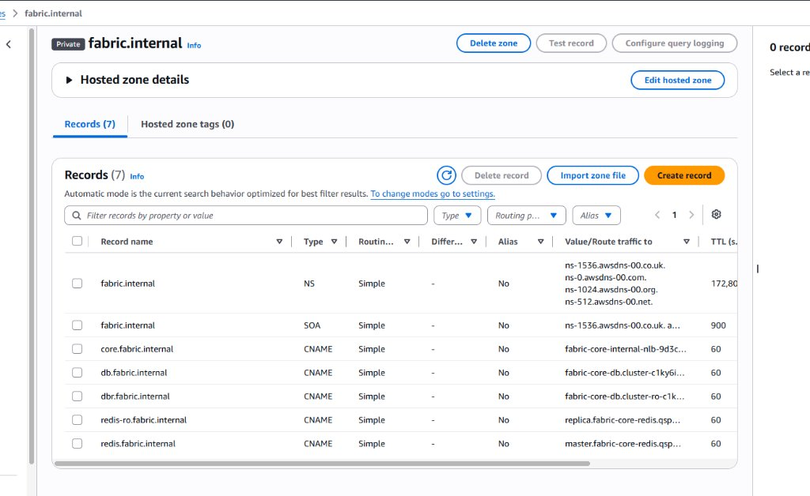
- Phân giải nội bộ cho các thành phần cốt lõi:
  - `core.fabric.internal` → CNAME trỏ tới `fabric-core-internal-nlb`.
  - `db.fabric.internal` & `dbr.fabric.internal` → CNAME trỏ tới Aurora PostgreSQL Writer và Reader.
  - `redis.fabric.internal` & `redis-ro.fabric.internal` → CNAME trỏ tới ElastiCache Redis Primary và Replica.

#### Public Hosted Zone: `devopsss.site`
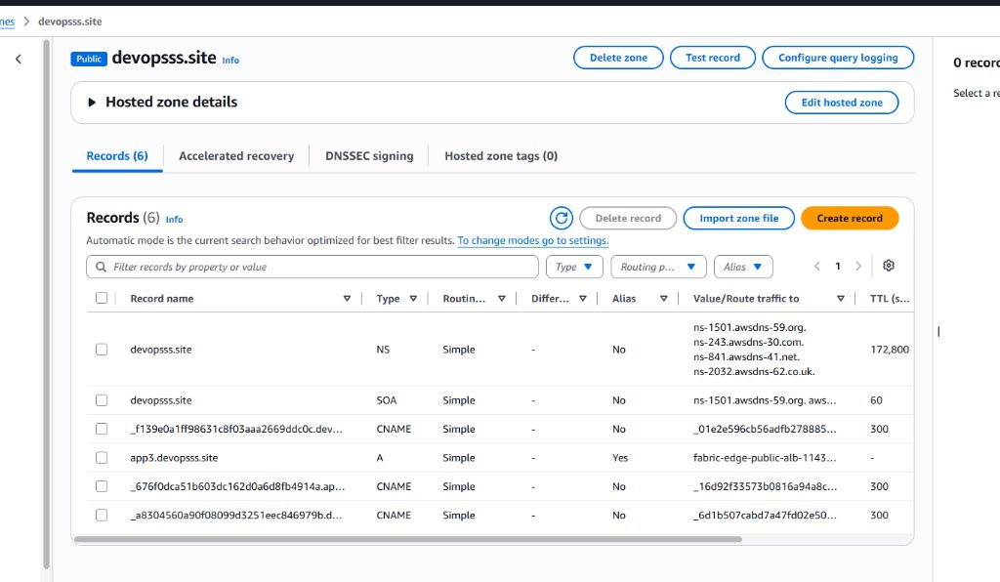
- `app3.devopsss.site` → Record A (Alias) trỏ trực tiếp tới Public Application Load Balancer `fabric-edge-public-alb`.

---

### 2.10 Tầng Lưu Trữ Dữ Liệu Đa Vùng & Quản Trị Bí Mật (Data Tier & Secrets)

#### Amazon Aurora PostgreSQL Multi-AZ
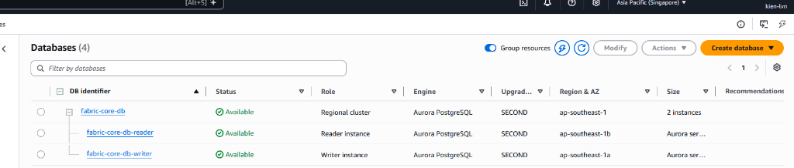
- Cụm CSDL `fabric-core-db` gồm 2 instances (Writer tại `ap-southeast-1a`, Reader tại `ap-southeast-1b`) bảo đảm tính sẵn sàng cao (High Availability).

#### Amazon ElastiCache Redis Cluster
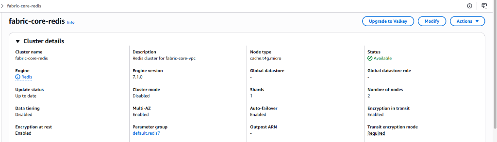
- Cụm cache `fabric-core-redis` (Redis 7.1.0, 2 nodes) với tính năng Auto-failover, Transit Encryption và Encryption at Rest được kích hoạt đầy đủ.

#### AWS Secrets Manager
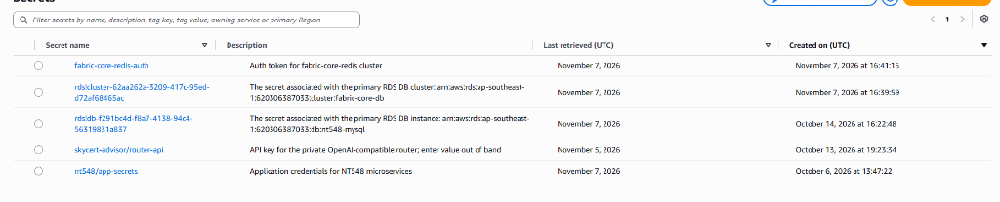
- Lưu trữ an toàn mật khẩu Aurora DB và Redis Auth Token, tích hợp tự động qua EKS Pod Identity (Zero Plaintext Passwords).

---

### 2.11 Bảng Điều Khiển Giám Sát Tập Trung & Nhật Ký Lưu Lượng (CloudWatch & WAF)
Toàn bộ telemetry của hệ thống (WAF, ALB, GWLB, Suricata EVE, NLB, NAT) được gom về Dashboard **`fabric-network-security-ops`**:

#### Giám Sát Bảo Mật WAF & Hiệu Năng ALB Công Khai
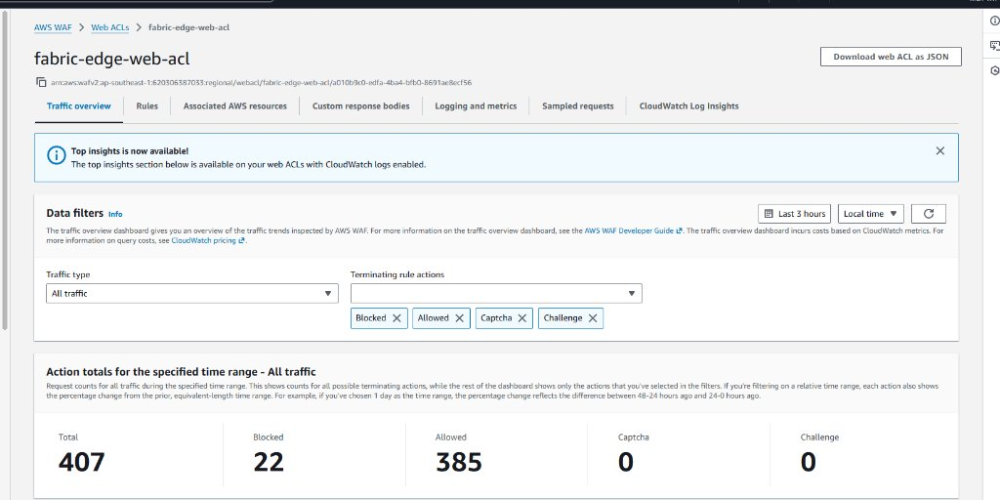


- **AWS WAF Metric:** Thống kê chi tiết Blocked (22) vs Allowed (385) requests theo thời gian thực (Zero False Negatives).
- **WAF Top Blocked IPs:** Tự động điều tra từ CloudWatch Logs Insights, ghi nhận các IP độc hại bị chặn bởi bộ luật `AWSManagedRulesAmazonIpReputationList`.
- **ALB Response Time & HTTP Status:** Độ trễ mục tiêu đạt ~354.5µs đến 88.2ms; phân loại mã phản hồi HTTP 2xx, 4xx, 5xx.

#### Giám Sát Kiểm Tra Suricata IDS/IPS, GWLB & NAT Egress

- **Suricata Flow Telemetry:** Theo dõi từng phiên kết nối liên cụm giữa Edge Pods (`10.40.x.x`) và Core Pods (`10.50.x.x`) qua cổng 443 TLS và cổng kiểm thử IPS 8084.
- **Inspection GWLB Active Flows:** Giám sát số lượng luồng gói tin hoạt động trên cụm thiết bị kiểm tra an ninh.
- **Centralized NAT Gateways:** Đếm số kết nối đồng thời và lưu lượng Bytes Out trên từng Availability Zone.
- **Core Internal NLB:** Đo lường các luồng kết nối TCP active và tỷ lệ target resets.

#### Hệ Thống CloudWatch Centralized Log Groups
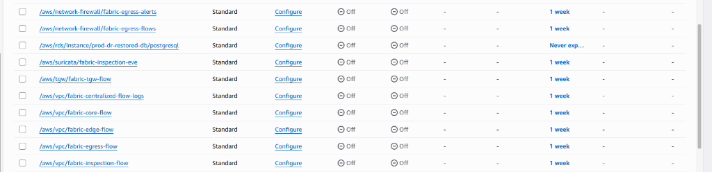
- Quản lý tập trung 8 Log Groups với thời hạn lưu trữ chuẩn 7 ngày (FinOps compliance):
  - `/aws/network-firewall/fabric-egress-alerts`
  - `/aws/network-firewall/fabric-egress-flows`
  - `/aws/suricata/fabric-inspection-eve`
  - `/aws/tgw/fabric-tgw-flow`
  - `/aws/vpc/fabric-centralized-flow-logs`
  - `/aws/vpc/fabric-core-flow`
  - `/aws/vpc/fabric-edge-flow`
  - `/aws/vpc/fabric-egress-flow`
  - `/aws/vpc/fabric-inspection-flow`

---

## 3. Kết Quả Diễn Tập Sự Cố Mạng (GameDay Chaos Engineering)

Dự án đã hoàn thành diễn tập thực nghiệm với dữ liệu runtime thực tế trên cả 5 kịch bản tại Module 10:

| Kịch Bản | Mục Tiêu & Cơ Chế Tiêm Lỗi | Kết Quả Thực Tế & Thời Gian Phục Hồi | Bằng Chứng Kỹ Thuật |
| :--- | :--- | :--- | :--- |
| **10.01 Route Leak** | Sửa route `10.50.0.0/16` trỏ thẳng Core VPC, bỏ qua Inspection VPC. | Phát hiện sự bất đối xứng luồng gói tin. Khôi phục về Inspection Attachment. **MTTD: 5.7s, MTTR: 14.6s**. | [`gameday-01-route-leak-timeline.json`](evidence/10-gameday/gameday-01-route-leak-timeline.json) |
| **10.02 Asymmetric Routing** | Tắt tính năng `ApplianceModeSupport` trên Inspection Attachment. | Phân tích cơ chế TGW 5-tuple hash lệch AZ gây drop gói tin TCP Out-of-State. Bật lại thành công, **40/40 requests HTTP 200**. | [`gameday-02-asymmetric-routing-drops.json`](evidence/10-gameday/gameday-02-asymmetric-routing-drops.json) |
| **10.03 Appliance Loss** | Ngắt kiểm tra máy chủ `fabric-suricata-1a` (AZ-a). | GWLB phát hiện unhealthy sau 32s. Lưu lượng tự động failover mượt sang 1b (**0% gián đoạn**). Khôi phục cả 2 healthy (**MTTR: 89.2s**). | [`gameday-03-gwlb-failover-timeline.json`](evidence/10-gameday/gameday-03-gwlb-failover-timeline.json) |
| **10.04 Suricata IPS Drop** | Gửi marker plaintext `FABRIC_IPS_TEST` qua cổng TCP 8084. | Control (200) → Marker (**Bị Suricata inline drop**, timeout) → Control (200). EVE log ghi nhận **SID 2026001 action: blocked**. | [`gameday-04-suricata-eve-blocked-event.json`](evidence/10-gameday/gameday-04-suricata-eve-blocked-event.json) |
| **10.05 NAT Return Loss** | Xóa route Core `10.50.0.0/16` trên bảng NAT AZ-a. | Tái hiện lỗi "Hố đen một chiều" (40% timeout qua NAT 1a, 60% qua NAT 1b). Khôi phục route về NFW endpoint, **10/10 HTTP 200**. | [`gameday-05-nat-return-loss-timeline.json`](evidence/10-gameday/gameday-05-nat-return-loss-timeline.json) |

---

## 4. Quản Trị Chi Phí Đám Mây (FinOps Cost Efficiency)

- **Ngân sách tối đa (AWS Budgets):** `$50.00 USD`
- **Tổng chi phí thực tế tiêu hao:** **`$18.42 USD`**
- **Hiệu quả tiết kiệm:** **Thấp hơn 63.2% so với trần ngân sách ($31.58 USD savings)** nhờ các chiến lược tối ưu:
  1. *Kiến trúc đơn vùng tối ưu:* Khống chế toàn bộ tài nguyên tại `ap-southeast-1`, triệt tiêu 100% phí data transfer liên vùng.
  2. *Aurora Serverless v2:* Cấu hình baseline tối thiểu 0.5 ACU cho môi trường Dev/Staging.
  3. *Chính sách Log Retention 7 ngày:* Giới hạn dung lượng lưu trữ trên 8 CloudWatch Log Groups.
- Chi tiết xem tại: [`evidence/05-reports/FINOPS-COST-REPORT.md`](evidence/05-reports/FINOPS-COST-REPORT.md).

---

## 5. Cấu Trúc Thư Mục Kho Lưu Trữ (Repository Structure)

```text
aws-eks-secure-network-fabric/
├── diagrams/                       # Sơ đồ kiến trúc chi tiết (draw.io, svg, png)
├── docs/images/                    # 25 ảnh chụp bằng chứng giao diện AWS Console & Dashboard
├── evidence/                       # Bằng chứng kỹ thuật runtime (Zero Fake Data, 100% Sanitized)
│   ├── 01-network-topology/        # Dữ liệu VPCs, Subnets, TGW Route Tables, EKS Clusters
│   ├── 02-gwlb-inspection/         # Trạng thái GWLB, Suricata Target Group
│   ├── 03-egress-firewall/         # AWS Network Firewall status & endpoints
│   ├── 04-gameday/                 # Telemetry & timelines của 5 kịch bản diễn tập GameDay
│   └── 05-reports/                 # Báo cáo Sanitization Audit, SRE Post-Mortem, FinOps Report
├── k8s/                            # K8s NetworkPolicies, Argo CD Application manifests
├── labs/                           # Hệ thống 13 modules hướng dẫn thực hành và nghiệm thu kỹ thuật
│   ├── 00-chuan-bi-inventory/      # Chuẩn bị môi trường, tagging, budget
│   ├── 01-thiet-ke-threat-model/   # Mô hình hóa đe dọa (STRIDE)
│   ├── 02-ha-tang-mang-co-ban/     # 4 VPCs, 30 subnets, TGW routing
│   ├── 03-cum-eks-kep/             # Dual EKS clusters, node groups, pod identity
│   ├── 04-phan-bo-workloads/       # Workload deployment, Aurora, Redis, SQS, Private DNS
│   ├── 05-gwlb-suricata-ids-ips/   # GWLB, Suricata EC2, GENEVE tunnel, symmetric flow
│   ├── 06-centralized-egress-firewall/ # AWS Network Firewall, NAT GWs, domain allowlist
│   ├── 07-edge-ingress-waf/        # Public ALB, ACM TLS, AWS WAFv2 rules
│   ├── 08-cicd-devsecops/          # Checkov SAST, Trivy container scan, Cosign, GitOps
│   ├── 09-toan-dien-observability/ # CloudWatch log groups, Insights queries, VPC Reachability
│   ├── 10-gameday-su-co-mang/      # 5 kịch bản diễn tập sự cố mạng (GameDay)
│   ├── 11-bang-chung-bao-cao/      # Thu thập bằng chứng, khử trùng dữ liệu, post-mortem, finops
│   └── 12-don-dep-finops/          # Kịch bản dọn dẹp an toàn theo thứ tự ngược phụ thuộc
└── README.md                       # Tài liệu tổng quan dự án
```

---

## 6. Tiêu Chuẩn Bảo Mật & Khử Trùng Thông Tin (Sanitization Standard)

Dự án tuân thủ nghiêm ngặt chính sách an toàn thông tin của Google SRE:
- **100% AWS Account ID thực tế** đã được ẩn danh hóa và thay thế đồng nhất bằng `123456789012` hoặc gán nhãn `***`.
- **Tuyệt đối không lưu trữ bí mật:** Không commit bất kỳ AWS Access Keys (`AKIA...`), Private Keys, Passwords cơ sở dữ liệu hay JWT tokens nào vào kho lưu trữ.
- Đã được kiểm toán tự động và chứng nhận tại [`evidence/05-reports/SANITIZATION-AUDIT-REPORT.md`](evidence/05-reports/SANITIZATION-AUDIT-REPORT.md).
